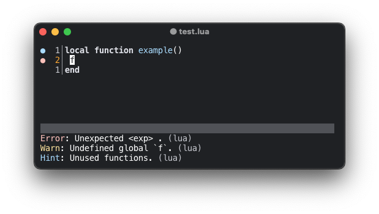

# Chime.nvim 🚦

Chime is a very little diagnostic handler that echoes the diagnostics of the
current line to the echo / message area. It pairs really well with the new ui2
message area.

Chime is very configurable and aims to be as Neovim native as possible.



## Installation

To install, use your favorite plugin manager. For example with
the builtin Nvim 0.12+ `vim.pack`:

```lua
vim.pack.add({ { 'https://github.com/yochem/chime.nvim' } })
```

For lazy-loading you could try `event = 'DiagnosticsChanged'`, although the
auto-loaded `plugin/` only contains 13 SLOC and is already very light.

## Configuration

This plugin aims to do everything _the Neovim way_. Because it handles
diagnostics, it's an [`diagnostic-handler`][handlers]. This means configuration
is handled using `vim.diagnostic.config()`, **not** `setup()`. It also listens
to global configuration options for diagnostic handlers, and you can enable it
only for certain namespaces. See [`vim.diagnostic.config`][config] for more
info.

Below is the default configuration:

```lua
vim.diagnostic.config({
  chime = {
    format = --[[ builtin function ]],
    severity = nil,
    severity_sort = false,
    trim = true,
  }
})
```

### Format

Set the format of the diagnostic message with the `format` config option. It
should be a function that receives a diagnostic and outputs either a string or
a list of colored chunks (like the first argument of
[`vim.api.nvim_echo()`][nvim_echo]).

An example that returns the formatted string `[INFO] Unused functions. (luals)`:

```lua
vim.diagnostic.config({
  chime = {
    ---@param d vim.Diagnostic
    format = function(d)
      return ('[%s] %s (%s)'):format(
        vim.diagnostic.severity[d.severity],
        d.message,
        d.source,
      )
    end
  }
})
```

And the same diagnostic but with the sign text highlighted in its color and the
source in gray:

```lua
vim.diagnostic.config({
  chime = {
    ---@param d vim.Diagnostic
    format = function(d)
      local severity_text = vim.diagnostic.severity[d.severity]
      local severity_color = ({
          'DiagnosticError',
          'DiagnosticWarn',
          'DiagnosticInfo',
          'DiagnosticHint',
      })[d.severity]

      return {
        { ('[%s] '):format(severity_text), severity_color },
        { d.message },
        { (' (%s)'):format(d.source), "Comment" },
      }
    end
  }
})
```

### Severity

Filter on severities, for example only show errors in Chime. See
[`diagnostic-severity`][diagnostic-severity].

### Severity Sort

Sort by severity. It is recommended to set this to true. See
[`vim.diagnostic.Opts`][diagnostic-Opts].

### Trim

The trim option defaults to `true` and trims the diagnostic message to fit
`|v:echospace|`, ensuring you'll never see the [`Press
ENTER`](https://github.com/neovim/neovim/issues/22478) prompt. You might set
this to `false` if you use the new ui2 command line.

## Toggle or Disable Chime

Chime can be enabled or disabled on the fly:

```vim
" disable Chime
:lua vim.diagnostic.config({ chime = false })
" and enable again
:lua vim.diagnostic.config({ chime = true })
```

May you wish to only manually show the diagnostics, disable the handler and map
the `show()` method yourself.

```lua
vim.diagnostic.config({ chime = false })

vim.keymap.set('n', '<leader>d', function()
  require('chime').show()
end)
```

## Comparison

The main functionality of this plugin is inspired by
[seblyng/nvim-ech-diagnostics](https://github.com/seblyng/nvim-echo-diagnostics),
which I have used with pleasure for some years. This plugin aims to have the
same functionality as nvim-echo-diagnostics, but in a more modern Neovim way
(by being a diagnostic handler). I figured this was to much of a breaking
change to upstream to nvim-echo-diagnostics, so here we are.

[handlers]: https://neovim.io/doc/user/diagnostic/#_handlers
[config]: https://neovim.io/doc/user/diagnostic/#vim.diagnostic.config()
[nvim_echo]: https://neovim.io/doc/user/api.html#nvim_echo()
[diagnostic-severity]: https://neovim.io/doc/user/diagnostic.html#diagnostic-severity
[diagnostic-Opts]: https://neovim.io/doc/user/diagnostic.html#vim.diagnostic.Opts
